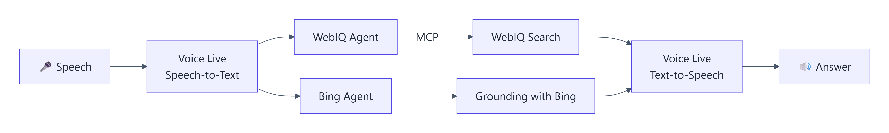
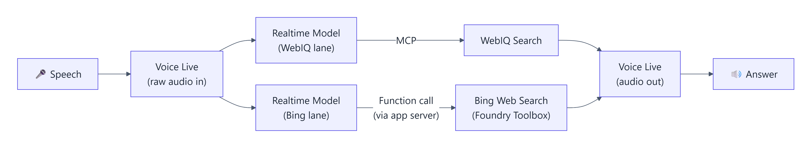

# TMAP 음성 검색 비교: WebIQ vs Grounding with Bing

TMAP 차량 음성 에이전트에 붙일 웹 검색을 고르기 위한 데모다. 같은 질문(텍스트 또는 음성)을
WebIQ와 Grounding with Bing에 동시에 보내고, 검색·답변 과정과 걸린 시간을 나란히 보여 준다.
Azure Voice Live와 Microsoft Foundry Agent를 사용한다.

> 키·토큰·구독 같은 환경 값은 코드와 결과 파일에 넣지 않는다. 검색·모델·음성 호출에는 사용량 비용이 든다.

## 두 가지 방식

| | Agent 연결(기본) | End-to-end |
| --- | --- | --- |
| 흐름 | STT → Foundry Agent(검색 도구) → TTS | Realtime 음성 모델이 직접 듣고 검색한다 |
| WebIQ | Agent → MCP | 모델 → MCP |
| Bing | Agent → Grounding with Bing | 모델 → 앱 서버 → Foundry Toolbox Web Search |
| 쓰임 | 공정 비교: 같은 모델·지시, 검색 도구만 다르다 | 응답 속도 확인 |




설정 항목과 서비스 제약은 [음성 설정](docs/VOICE_OPTIONS.md)에 있다.

## Azure 배포

```bash
az login
python scripts/provision.py --subscription <구독> --resource-group <리소스 그룹>          # 계획(읽기만)
python scripts/provision.py --subscription <구독> --resource-group <리소스 그룹> --apply  # 생성
```

Foundry·검색 리소스, 검색 Agent, 이미지, Microsoft Entra 로그인까지 한 번에 만든다.
WebIQ 키는 `WEBIQ_API_KEY` 또는 실행 중 숨김 입력으로 받는다. 코드 갱신과 키 교체는 [배포](docs/DEPLOYMENT.md)를 본다.

## 로컬 실행

WSL Ubuntu에서 실행하고 Windows 브라우저로 접속한다. 프런트엔드 빌드는 없다.

```bash
cp config/runtime.example.env .env        # provision.py가 출력한 값을 넣는다
export UV_PROJECT_ENVIRONMENT="$HOME/.cache/tmap-webiq-poc/$(basename "$PWD")-venv"
uv sync --frozen
uv run tmap serve --port 8000
```

http://localhost:8000 을 연다. 다른 포트를 쓰면 `TMAP_ALLOWED_ORIGINS`에 그 주소를 추가한다.
기존 Foundry 프로젝트에 Agent를 등록할 때는 `uv run tmap prepare-agents`(계획)와 `--apply`(등록)를 쓴다.

## 테스트

Azure를 호출하지 않는다.

```bash
uv run python -m unittest discover -s tests   # 서버·스크립트
node --test tests/frontend.test.cjs           # 화면
python scripts/scan_secrets.py                # 커밋 전 비밀값 검사
```

## 구조

| 위치 | 내용 |
| --- | --- |
| `src/tmap_poc/api.py`, `cli.py` | 웹 API와 WebSocket(`/ws/voice`), `tmap serve`, `tmap prepare-agents` |
| `src/tmap_poc/voice.py`, `voice_options.py` | Voice Live 세션과 이벤트 중계, 음성 설정 검증 |
| `src/tmap_poc/webiq_mcp.py`, `web_search.py` | WebIQ MCP 연결, Toolbox Web Search 호출 |
| `src/tmap_poc/profiles.py` | 두 Agent의 공통 지시와 검색 도구 |
| `src/tmap_poc/app_settings.py`, `auth.py`, `config.py` | 환경 설정, Azure CLI·Managed Identity 인증 |
| `src/tmap_poc/telemetry.py`, `tool_spans.py`, `serialization.py` | Trace, 도구 span, 인용 정리 |
| `src/tmap_poc/static/` | 비교 화면 |
| `infra/`, `scripts/` | Bicep 템플릿, 배포·키 교체·연결 점검·비밀값 검사 |
| `docs/`, `results/` | 문서와 근거 결과 |

## 문서

- [배포](docs/DEPLOYMENT.md)
- [음성 설정](docs/VOICE_OPTIONS.md)
- [Trace](docs/TRACING.md)
- [검증 기록](docs/VOICE_STATUS.md)
- [V9 텍스트 검색 벤치마크](docs/REPORT.md): 2026-09-08, 30질문 × 3조건. 실행 코드는 저장소에 없다.

## GitHub 인증

앱과 `gh`의 기본 계정은 `eonlee_MSDEMO`로 유지한다. `EON-LEE/*` 저장소의 fetch와 push에는
이미 로드된 EON-LEE Git 자격 증명을 사용한다. `~/.gitconfig-eonlee-auth`를 명령별
`include.path`로 다시 포함하지 않는다. 중복 `Authorization` 헤더가 생기면 HTTP 400 오류가 발생할 수 있다.

`gh`로 `EON-LEE/*` 저장소에 쓰기 작업을 할 때만 `gh auth token --user EON-LEE`로 토큰을 가져와
현재 프로세스 또는 명령의 `GH_TOKEN`에 설정한다. 작업이 끝나면 `GH_TOKEN`을 제거한다. 전역
`gh auth login`, `gh auth switch`, 공유 자격 증명 설정 변경은 사용하지 않는다.
