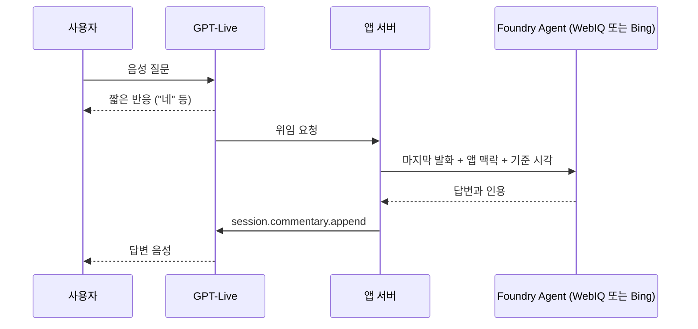

# 음성 설정

오른쪽 위 **설정** 패널의 값은 두 엔진에 똑같이 적용된다. 값을 바꾸면 초안이 되고, **적용**을 눌러야 반영된다.
적용하면 진행 중인 비교 연결을 끝내고 다음 질문부터 새 설정을 쓴다(음성은 말하기를 다시 누른다).
**취소**는 초안을 적용된 설정으로 되돌리고, **기본값**은 초안만 기본값으로 채운다. 적용하지 않은 초안이 있으면
설정 버튼에 "적용 안 됨"이 표시된다. 화면 위에는 지금 적용된 방식이 항상 보인다.
같은 패널의 **뉴스 브리핑** 항목은 [뉴스 브리핑 평가](NEWS_BRIEFING.md)에 설명한다.

## 방식

| 방식 | `connection_mode` | 흐름 | 쓰임 |
| --- | --- | --- | --- |
| Agent 연결(기본) | `agent` | STT → Foundry Agent → TTS. 두 Agent는 같은 모델·지시를 쓰고 검색 도구만 다르다 | 검색 엔진 공정 비교 |
| End-to-end | `end_to_end` | Realtime 모델이 음성을 직접 듣고 말한다. WebIQ는 세션 MCP 도구, Bing은 앱 서버가 부르는 Toolbox Web Search(없으면 Bing Agent)를 쓴다 | 응답 속도 확인 |
| GPT-Live | `gpt_live` | GPT-Live가 음성을 직접 듣고 말한다. 검색이 필요하면 앱에 위임하고, 앱은 엔진의 Foundry Agent를 불러 결과를 돌려준다 | 한국어 음성 확인, 말하는 중 반응 확인 |

GPT-Live는 `POC_LIVE_ENDPOINT`와 `POC_LIVE_DEPLOYMENT`가 모두 있을 때만 고를 수 있다. 배포는 [배포](DEPLOYMENT.md)의 GPT-Live 절을 본다.

## 항목

| 항목 | 선택 | 적용 범위 |
| --- | --- | --- |
| Realtime 모델 | `gpt-realtime`, `gpt-realtime-mini` | End-to-end |
| STT | Azure Speech(기본), MAI Transcribe(preview) | Agent 연결. End-to-end는 모델이 직접 듣는다 |
| TTS 음성 | Azure Neural·DragonHD 한국어 음성. End-to-end는 OpenAI native 음성도 고를 수 있다 | 둘 다 |
| TTS 말하기 속도 | 0.5–1.5배 | Azure 음성 |
| 발화 종료 감지 | Azure 다국어 Semantic VAD(기본), Server VAD | 둘 다 |
| 지연 관련 | 무음 대기(100–2000 ms), VAD 임계값(0–1), 의미 기반 종료 임계값, 말로 답변 끊기, 서버 소음 억제, 서버 에코 제거 | 둘 다 |
| GPT-Live 음성 (`live_voice`) | `noeul`(기본, 한국어 권장), `marin`(GPT-Live 기본 음성, 영어) | GPT-Live |
| GPT-Live 답변 언어 (`live_language`) | `korean`(기본, 항상 한국어), `follow_user`(사용자 언어 따라가기), `none`(언어 지시를 넣지 않음) | GPT-Live |
| GPT-Live 맞장구 (`live_backchannel`) | `none`, `sometimes`(기본), `often` | GPT-Live |

빈 숫자와 "기존 서비스 설정 유지"는 서비스 기본값을 쓴다. 지연 설정은 발화 감지·재생 설정이며
검색이나 추론 시간을 줄이지 않는다. GPT-Live에서는 위 세 항목만 바꿀 수 있고 Voice Live 항목은 숨긴다.
GPT-Live 항목은 다른 방식에서 기본값이 아니면 오류로 거부한다.

## 서비스에서 확인한 제약

- End-to-end는 엔진마다 모델이 음성을 따로 듣는다. 같은 말도 두 엔진이 다르게 이해할 수 있어, 엔진 비교에는 Agent 연결을 쓴다.
- End-to-end 자막은 별도 인식 모델이 만들어 모델이 이해한 내용과 다를 수 있다. 그래서 화면에 표시하지 않는다.
- 세션 MCP 도구는 도구 목록이 준비되기 전에 질문하면 도구 없이 답한다. 앱은 목록이 준비된 뒤에 준비 완료를 알린다.
- MCP 검색으로 끝난 응답 뒤에는 서비스가 스스로 답하지 않는다. 앱은 검색 결과가 온 뒤 후속 응답을 요청한다(발화당 최대 3회).
- WebIQ 세션 도구는 `web`, `news`, `places`, `finance`만 허용한다.
- Voice Live가 Toolbox Web Search를 직접 부르면 결과가 빈 글이 된다. 그래서 앱 서버가 대신 호출한다. 검색 한 번에 9–14초 걸렸다(WebIQ 0.5–0.7초).
- End-to-end에서 Bing이 Bing Agent로 연결되면 Agent 답변을 그대로 전달한다. OpenAI native 음성은 이 직접 전달과
  함께 쓸 수 없어, native 음성을 고르면 선택한 모델이 답변을 다시 구성한다(API 값 `return_agent_response_directly`).
- WebIQ 키는 세션을 시작할 때 프로젝트 연결에서 읽어 서버 메모리에만 최대 10분 둔다. 브라우저, 로그, trace에는 보내지 않는다.

## GPT-Live

엔진마다 GPT-Live 세션을 하나씩 열고, 같은 마이크 음성을 두 세션에 보낸다. 앱은 세션 시작 때 위임 방식을
클라이언트 위임(`delegation: {"type": "client"}`)으로 정한다. GPT-Live가 위임을 요청하면 앱은 사용자의 마지막 발화를
그 엔진의 Foundry Agent에 Responses API로 보내고, Agent 답변을 `session.commentary.append`로 돌려준다.
GPT-Live는 이 답변을 자기 음성으로 말한다.

- 음성으로만 대화한다. 텍스트 질문은 `live_voice_only` 오류로 거부한다(연결은 유지).
- 지시문(instructions)은 영어로 쓰고, 고른 언어·맞장구 지시와 현재 서울 시각을 넣는다.
- 음성은 세션을 시작할 때 정한다. 바꾸려면 설정을 적용하고 말하기를 다시 누른다.
- 세션은 최대 900초, Agent 호출은 60초까지 기다린다. Agent 호출이 실패하면 GPT-Live에 다시 질문해 달라고 안내하게 한다.
- GPT-Live가 적용되어 있어도 뉴스 브리핑 화면은 Agent 연결로 실행한다.

### 한국어 음성 진단

GPT-Live로 질문하면 엔진 카드마다 **한국어 음성 진단**이 나온다. 한국어 음성이 돌아오지 않는 원인을
다음 순서로 좁힌다.

| 점검 | 확인하는 것 |
| --- | --- |
| 세션 시작·음성 | 세션이 열렸는지, 서비스가 돌려준 음성이 요청한 음성과 같은지 |
| 음성 수신 | 답변 음성(24 kHz PCM16)을 몇 초 받았는지. 전사는 있는데 음성이 없으면 "답변 전사는 있지만 음성이 오지 않음"으로 표시한다 |
| 답변 한글 비율 | 답변 전사의 글자 중 한글 비율. 80% 이상은 정상, 30% 이상은 섞임, 그 미만은 한국어 아님 |
| 위임 | 위임 요청 수, 결과 전달 수, 실패 |
| 오류·종료 | 최근 오류 3개, 세션 종료 이유와 사용 시간 |

**음성·언어 지시 조합별 기록** 표는 조합(예: Noeul + 항상 한국어, Marin + 항상 한국어, Marin + 지시 없음)마다
마지막 결과를 이 브라우저에 남긴다. 같은 질문을 조합만 바꿔 말하면 원인이 음성인지 언어 지시인지 비교할 수 있다.

아직 실제 배포에서 확인하지 않은 항목:

- Azure의 `gpt-live-1`에서 `noeul` 음성을 쓸 수 있는지
- GPT-Live 연결 인증 범위(`https://cognitiveservices.azure.com/.default`)가 맞는지
- 지역별 `gpt-live-1` 할당량

## WebSocket API

브라우저와 같은 Origin에서 `/ws/voice`로 연결한다. Azure 배포에서는 Microsoft Entra 로그인이 필요하다.

| 방향 | 메시지 |
| --- | --- |
| 클라이언트 → 서버 | `{"type": "start", "provider": "webiq" 또는 "bing", "context": "", "voice_options": {...}, "news": {...}}`, `{"type": "text", "text": "..."}`, PCM16 24 kHz 모노 바이너리 프레임, `{"type": "stop"}` |
| 서버 → 클라이언트 | `status`, `activity`, `transcript`, `flow`, `tool`, `citation`, `audio`, `usage`, `response_done`, `interrupt`, `error`, `done` |
| 서버 → 클라이언트(GPT-Live) | `live_session`(모델, 음성, 지시문, 언어, 맞장구), `live_transcript`(사용자·GPT-Live 전사), `delegation`(`created`, `completed`, `failed`, `delivered`), `live_usage`, `live_closed`, 그리고 `status`, `audio`, `error` |

- `voice_options`를 빼면 Agent 연결 기본값을 쓴다. 모르는 키, 지원하지 않는 모드나 값은 오류로 거부한다.
- `news`는 뉴스 브리핑 설정(`freshness`, `count`, `length`, `cite`, `group_events`)이다. WebIQ에서만 받으며,
  Bing이면 `news_requires_webiq`, 값이 틀리면 `invalid_news_options` 오류로 거부한다.
- GPT-Live 오류 코드는 `live_` 뒤에 서비스 오류 코드를 붙인다. 앱이 만드는 코드는 `live_voice_only`,
  `live_start_timeout`(30초 안에 세션이 시작되지 않음), `live_closed_before_start`다.
- 질문과 앱 맥락은 각각 4,000자 이내, 오디오 프레임은 48,000바이트 이내다.
- 프로세스당 동시 세션은 4개다. 비교 화면은 질문마다 두 세션을 쓴다.
- `/api/config`는 클라우드를 호출하지 않는다. 엔진별 설정 상태, 선택 가능한 음성 설정, GPT-Live 설정 상태(`live`)를 돌려준다.
